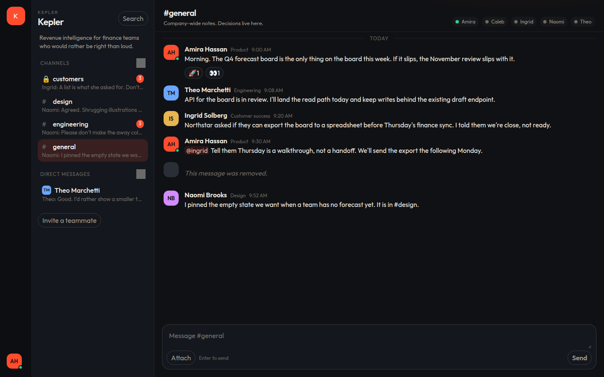
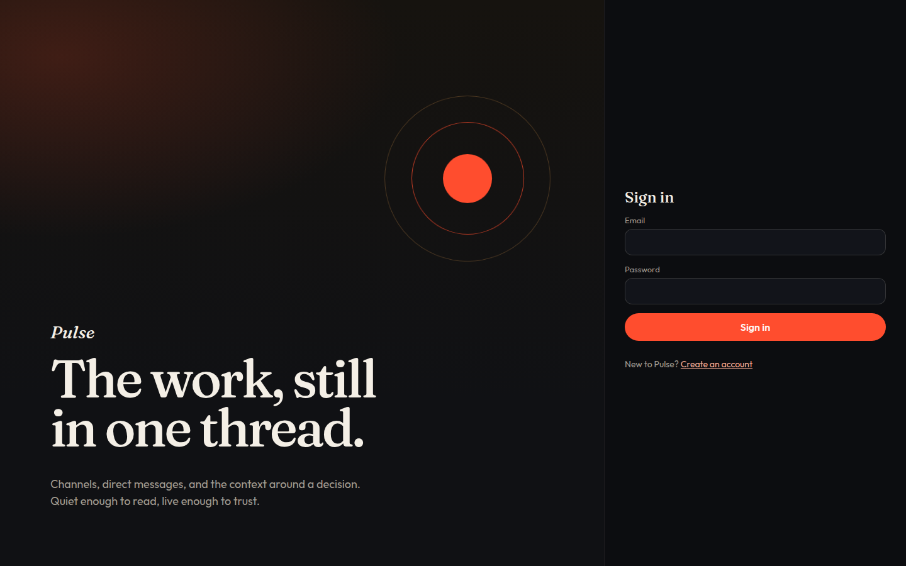
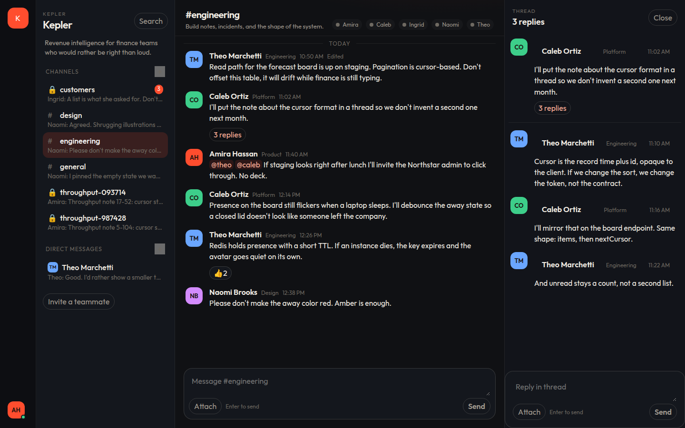
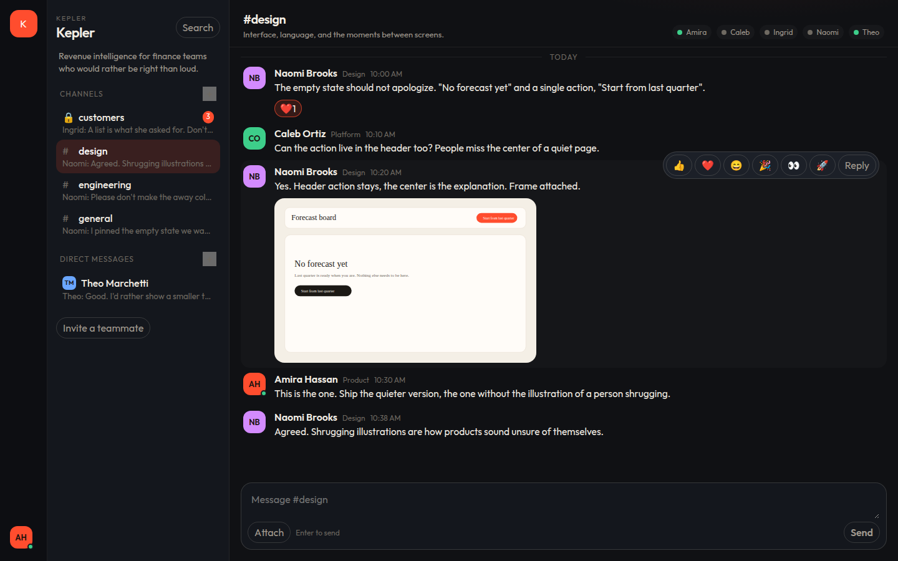
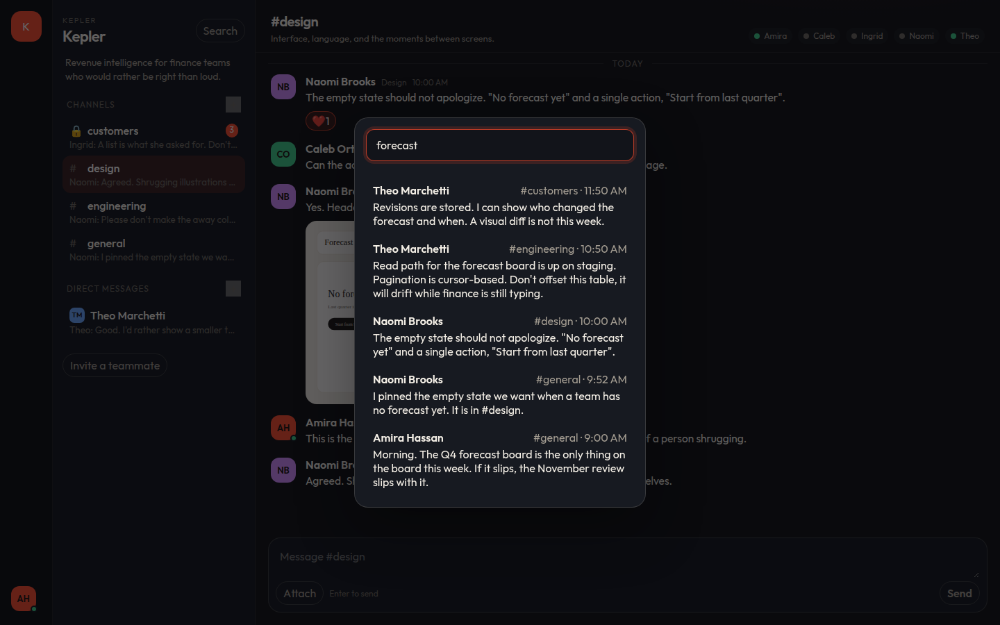
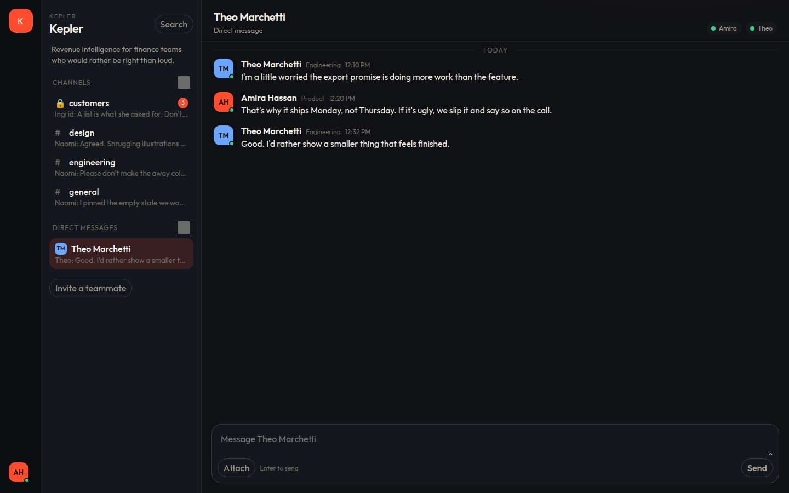
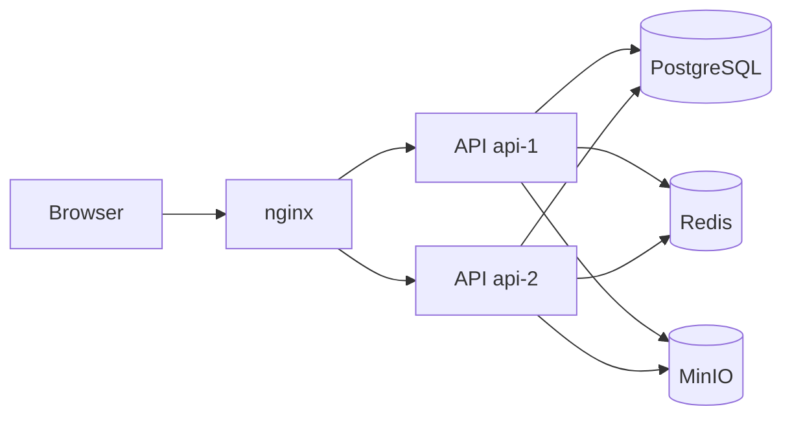
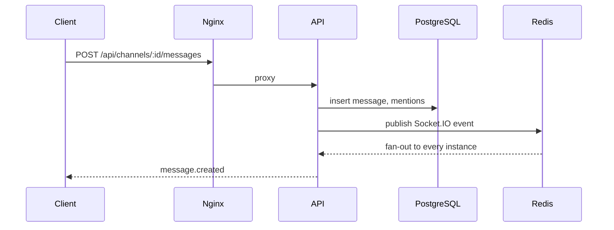

# Pulse

[](https://github.com/karagodini/pulse-chat/actions/workflows/ci.yml)

Pulse is a realtime messenger for product teams. People work in workspaces, talk in public and private channels, and keep decisions in threads instead of losing them in a scroll.



## Features

- Workspaces with owner, admin, and member roles, plus invite links
- Public channels, private channels, and direct messages
- Threads, emoji reactions, and `@handle` mentions
- Typing indicators and presence (online, away, offline)
- Unread counts that follow what you have actually read
- Image and file uploads, stored in S3-compatible object storage
- Edit and remove your own messages
- Full-text search across the conversations you can see
- JWT access tokens with rotating refresh tokens stored as hashes
- Two API instances behind nginx, with Socket.IO fan-out through Redis

## По-русски

Pulse — мессенджер для команд: пространства, открытые и закрытые каналы, личные сообщения, треды, реакции, упоминания, индикатор набора, присутствие, непрочитанные, вложения, поиск по сообщениям и несколько экземпляров API за nginx. Интерфейс на английском. Локальный запуск описан в разделе Quick start.

## Interface

Sign in, then the workspace you belong to.



A thread keeps a decision next to the message that started it. Presence for teammates with a live connection shows on the avatars.



Images sent in a channel render in the transcript.



Search runs against PostgreSQL full text and only returns conversations you can open.



Direct messages sit beside the channels.



## Architecture

Browser traffic lands on nginx. REST and WebSocket upgrades are spread across two API processes. Socket.IO uses the Redis adapter, so an event published on one instance is delivered to sockets connected to the other. Presence keys live in Redis with a short TTL. PostgreSQL holds the transcript. MinIO holds uploads, and the API returns short-lived signed URLs.



A message takes this path:



`GET /api/health` reports which process answered. With both replicas up, consecutive calls alternate:

```json
{"status":"ok","instance":"api-1","database":"ok","redis":"ok","time":"2026-11-10T07:35:33.576Z"}
{"status":"ok","instance":"api-2","database":"ok","redis":"ok","time":"2026-11-10T07:35:33.584Z"}
```

## Tech stack

| Area                 | Choice                                                           |
| -------------------- | ---------------------------------------------------------------- |
| Monorepo             | pnpm workspaces                                                  |
| API                  | NestJS, TypeScript, Socket.IO, Redis adapter                     |
| Data                 | PostgreSQL 16, Prisma, full-text search                          |
| Presence and fan-out | Redis 7                                                          |
| Files                | MinIO, S3 API, presigned downloads                               |
| Auth                 | JWT access tokens, rotating refresh tokens in an httpOnly cookie |
| Client               | React, Vite, TanStack Query, Zustand, virtualized transcripts    |
| Edge                 | nginx in front of two API replicas                               |
| Load                 | k6                                                               |

## Quick start

Docker Compose runs PostgreSQL, Redis, MinIO, a migration, the Kepler seed, two API replicas, the web client, and nginx.

```bash
cp .env.example .env
```

Fill every value. Generate signing secrets and passwords with hex so they do not need URL encoding:

```bash
openssl rand -hex 32   # JWT_ACCESS_SECRET and JWT_REFRESH_SECRET
openssl rand -hex 24   # POSTGRES_PASSWORD, S3_SECRET_KEY, SEED_USER_PASSWORD
openssl rand -hex 12   # S3_ACCESS_KEY
```

A working local file looks like this. Replace each generated value. Do not commit `.env`.

```bash
POSTGRES_USER=pulse
POSTGRES_PASSWORD=<hex>
POSTGRES_DB=pulse
DATABASE_URL=postgresql://pulse:<hex>@localhost:5432/pulse
REDIS_URL=redis://localhost:6379
S3_ENDPOINT=http://localhost:9000
S3_PUBLIC_ENDPOINT=http://localhost:9000
S3_REGION=us-east-1
S3_BUCKET=pulse
S3_ACCESS_KEY=<hex>
S3_SECRET_KEY=<hex>
JWT_ACCESS_SECRET=<hex>
JWT_REFRESH_SECRET=<hex>
ACCESS_TOKEN_TTL=15m
REFRESH_TOKEN_TTL_DAYS=14
COOKIE_SECURE=false
WEB_ORIGIN=http://localhost:8080
PORT=3000
INSTANCE_ID=local
SEED_USER_PASSWORD=<hex, at least 10 characters>
```

`docker-compose.yml` refuses to start when `JWT_ACCESS_SECRET`, `JWT_REFRESH_SECRET`, the database password, the object-storage credentials, or `SEED_USER_PASSWORD` are empty.

```bash
docker compose up --build
```

Open [http://localhost:8080](http://localhost:8080).

The seed creates the Kepler workspace for local development. Everyone shares `SEED_USER_PASSWORD`.

| Name           | Email            | Handle |
| -------------- | ---------------- | ------ |
| Amira Hassan   | amira@kepler.io  | amira  |
| Theo Marchetti | theo@kepler.io   | theo   |
| Naomi Brooks   | naomi@kepler.io  | naomi  |
| Caleb Ortiz    | caleb@kepler.io  | caleb  |
| Ingrid Solberg | ingrid@kepler.io | ingrid |

MinIO's server image is no longer published on Docker Hub. Compose builds it from the official `RELEASE.2025-04-22T22-12-26Z` binary and the matching `mc` client. The console is on port 9001. The S3 API is on port 9000, which is the host the browser uses for signed file URLs.

### Local processes

For API or client work outside Compose, point `DATABASE_URL`, `REDIS_URL`, and the S3 variables at the Compose services, then:

```bash
pnpm install
pnpm --filter @pulse/shared build
pnpm --filter @pulse/api exec prisma migrate deploy
pnpm --filter @pulse/api db:seed
pnpm dev:api
pnpm dev:web
```

The Vite server proxies `/api` and `/socket.io` to `http://localhost:3000`.

## Environment variables

| Variable                                            | Purpose                                                         |
| --------------------------------------------------- | --------------------------------------------------------------- |
| `POSTGRES_USER`, `POSTGRES_PASSWORD`, `POSTGRES_DB` | Database role and name                                          |
| `DATABASE_URL`                                      | Prisma connection string                                        |
| `REDIS_URL`                                         | Presence and Socket.IO adapter                                  |
| `S3_ENDPOINT`                                       | S3 API the API process calls                                    |
| `S3_PUBLIC_ENDPOINT`                                | Host baked into presigned URLs                                  |
| `S3_REGION`, `S3_BUCKET`                            | Bucket location. Compose defaults to `us-east-1` and `pulse`    |
| `S3_ACCESS_KEY`, `S3_SECRET_KEY`                    | Object storage credentials. Also used as the MinIO root account |
| `JWT_ACCESS_SECRET`, `JWT_REFRESH_SECRET`           | Signing secrets. Required. No defaults                          |
| `ACCESS_TOKEN_TTL`                                  | Access token lifetime, default `15m`                            |
| `REFRESH_TOKEN_TTL_DAYS`                            | Refresh token lifetime, default `14`                            |
| `COOKIE_SECURE`                                     | Set `true` behind HTTPS                                         |
| `WEB_ORIGIN`                                        | CORS origin                                                     |
| `PORT`                                              | API port, default `3000`                                        |
| `INSTANCE_ID`                                       | Name returned by `/api/health`                                  |
| `SEED_USER_PASSWORD`                                | Password for the seeded Kepler accounts                         |

## Load

`load/k6/messaging.js` signs in as Amira, opens a private channel, and has 20 virtual users list channels, read history, post, and search for 30 seconds.

```bash
k6 run -e BASE_URL=http://localhost:8080 -e SEED_USER_PASSWORD="$SEED_USER_PASSWORD" load/k6/messaging.js
```

Run against the Compose stack on this machine, k6 2.3.0, 10 November 2026:

| Metric            | Result              |
| ----------------- | ------------------- |
| Virtual users     | 20 for 30s          |
| Iterations        | 1,080               |
| HTTP requests     | 3,523 (115/s)       |
| Failed requests   | 0.43% (15 of 3,523) |
| Duration, average | 18.5 ms             |
| Duration, p95     | 53.8 ms             |
| Checks passed     | 99.6%               |

Thresholds in the script are `http_req_failed` under 5% and p95 under 800 ms. Both held. The script writes into a private channel named `throughput-*`, so the seeded transcript stays intact.

## Project structure

```
apps/api        NestJS API, Prisma schema, seed, Dockerfile
apps/web        React client and Dockerfile
packages/shared Event names and DTO types
infra/nginx     Edge proxy and the static client server
infra/minio     MinIO image build
load/k6         Messaging load script
docs            Interface captures
```

## Scripts

```bash
pnpm lint
pnpm format:check
pnpm typecheck
pnpm test
pnpm build
```

API integration coverage talks to PostgreSQL and Redis. It only runs when `DATABASE_URL` points at a database whose name ends in `test`, so it will not wipe a development database. CI uses `pulse_test`.

## Roadmap

- Saved messages and a personal inbox for mentions
- Per-channel notification levels and an email digest
- SSO for workspace owners
- An audit trail for invites, removals, and private channels
- Native clients that share the same socket protocol

## License

MIT. See [LICENSE](LICENSE).
